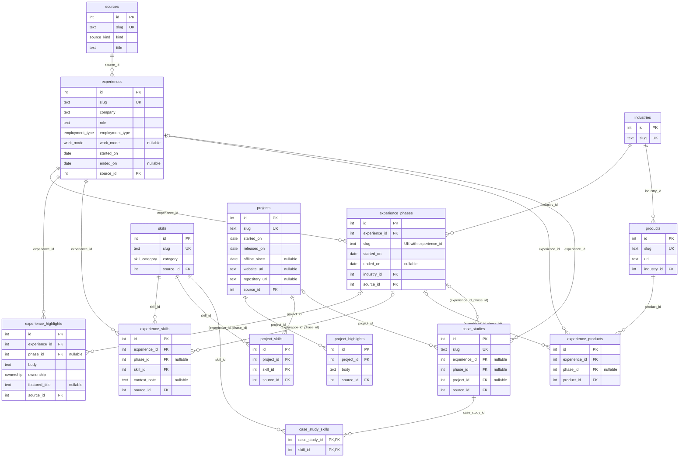

# @mirelnan/db

The database adapter: the Drizzle schema, the migrations, the seed (`writeCvData`), the repositories that
read the data back as `domain` types, and the command-line scripts that migrate and seed Neon. Nothing outside
this package sees a table or a database id; consumers get `domain` types through the repository interfaces.

## Public API

`package.json` exports only `src/index.ts`, so nothing else can be imported (no deep imports):

```ts
import { createDrizzleRepositories, type Database } from "@mirelnan/db";

const repositories = createDrizzleRepositories(db); // every domain port, read from Postgres
```

The composition root of each app calls it once. `writeCvData` stays internal: only the seed script in this
package uses it.

## Data model

Each `domain` aggregate is split into a root table and one table per list. `id` is a surrogate key used only
inside the database; the domain identity is `slug` (`code` for languages).



`||--o{` reads "one to zero or more"; `|o--o{` is the same with an optional parent (a nullable foreign key).
Not drawn, to keep the diagram readable: `profiles`, `education` and `languages` (simple tables with a
`source_id`), the `source_id` link of every table except `experiences`, and the `position` column that every
list has. The full definition is in [`src/schema`](src/schema) and the SQL in [`migrations`](migrations).

## Rules the database enforces

The `domain` schemas validate the data before the seed writes it; the constraints repeat the important rules,
so the database stays consistent even when it is written to directly.

| Rule                                                          | Constraint                                                                |
| ------------------------------------------------------------- | ------------------------------------------------------------------------- |
| A period does not end before it starts                        | `CHECK` on `experiences`, `experience_phases`, `projects`, `education`    |
| A release is within the project period; offline after release | `projects_release_check`, `projects_offline_check`                        |
| A phase slug is unique within its experience                  | `UNIQUE (experience_id, slug)`                                            |
| A part of an experience can only point to one of its phases   | composite foreign key `(experience_id, phase_id)` → `experience_phases`   |
| A skill or product appears once per phase (or once without)   | `UNIQUE NULLS NOT DISTINCT (experience_id, phase_id, …)`                  |
| A case study is about an experience (and phase) or a project  | `case_studies_about_check`                                                |
| Enum values match the domain                                  | Postgres enums built from the `domain` zod enums                          |
| Parts are deleted with their aggregate, nothing else is       | `ON DELETE CASCADE` inside an aggregate; references between them block it |

A phase must also lie within its experience's period. That rule compares two tables, so it stays in the
`domain` schema rather than in a trigger.

## Seed

`writeCvData(db, data)` rebuilds the database from `@mirelnan/cv-data`, the source of truth:

1. It validates the data with `cvDataSchema` from `domain`; invalid data is rejected before the database is touched.
2. In one transaction, it empties every table (`TRUNCATE … RESTART IDENTITY CASCADE`) and inserts all rows in
   dependency order, so running it again gives the same rows with the same ids.
3. A slug that points to nothing throws an error naming it, and the transaction rolls back completely.

It takes the driver-independent `Database` type (`src/database.ts`): the tests run it on PGlite, an in-memory
Postgres, with the real migrations; from step 3 it runs on Neon.

## Repositories

One factory per port in [`src/repositories`](src/repositories), `createDrizzle<Entity>Repository(db)`:

- Each query selects the domain's columns explicitly and turns a foreign key into its slug with a join
  (`innerJoin` for a required reference, `leftJoin` for a nullable one such as `phase_id` → `phaseSlug`).
- An aggregate (experience, project, case study) is read in a fixed number of queries, however many rows there
  are: one for the roots, then one per list, filtered with `inArray(parent_id, ids)` and run in parallel. The rows
  are grouped by parent (keeping `position` order) and turned back into domain values by the pure functions in
  `to-domain.ts`, the reverse of the seed (dates → months and periods, `featured_title` → `featured`, the store
  columns → `mobileApp`, the three references → `about`).
- `list()` and `getBySlug()` share the same loader; `getBySlug` only adds a `where`, and returns `null` when
  nothing matches.

The tests are round trips: seed the data, read it back, compare with `toStrictEqual`. They add a fictitious
project and a case study about it, so the Project aggregate is covered before the CV has any project.

## Commands

| Command                                         | What it does                                                                              |
| ----------------------------------------------- | ----------------------------------------------------------------------------------------- |
| `pnpm --filter @mirelnan/db db:generate --name` | Writes a new SQL migration from the schema changes (no database needed)                   |
| `pnpm --filter @mirelnan/db db:check`           | Checks that the migrations and their snapshots are consistent                             |
| `pnpm --filter @mirelnan/db test`               | Runs the seed and repository tests on PGlite (in-memory Postgres)                         |
| `pnpm --filter @mirelnan/db db:migrate`         | Applies the migrations not applied yet (owner URL from `.env.local`)                      |
| `pnpm --filter @mirelnan/db db:seed`            | Rebuilds every table from `cv-data` in one transaction (owner URL)                        |
| `pnpm --filter @mirelnan/db db:reader`          | Creates the read-only role or rotates its password; writes its URL to `.env.reader.local` |

Migrations are generated, reviewed in the pull request and committed; they are never edited by hand, and
`drizzle-kit push` is never used against production.

### Connecting to Neon

Copy `.env.example` to `.env.local` (git-ignored) and set `DATABASE_ADMIN_URL`: the owner role's direct
connection string (pooling off), with `sslmode=verify-full`. Only `db:migrate` and `db:seed` read it, on your
machine; the scripts use node-postgres (`src/client.ts`) and never print the URL. The web app gets a read-only
role instead.

### The read-only role

The web app connects as `portfolio_reader`, which can `SELECT` the tables in `public` and nothing else: no
writes, no DDL, no access to the `drizzle` schema. It is created with SQL, because Neon makes console-created
roles members of `neon_superuser`. `db:reader` creates it, or gives it a new password if it exists, logs in
as it to check that it can read, and writes `DATABASE_URL` to `.env.reader.local` (git-ignored, mode 600)
instead of printing it. `ALTER DEFAULT PRIVILEGES` covers the tables added by later migrations. Rotating the
password breaks the running app until its `DATABASE_URL` is updated.
